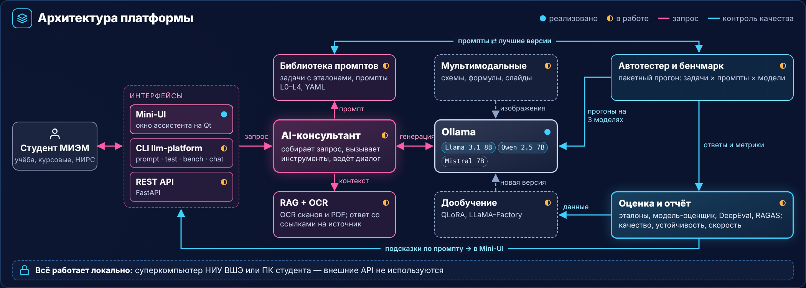
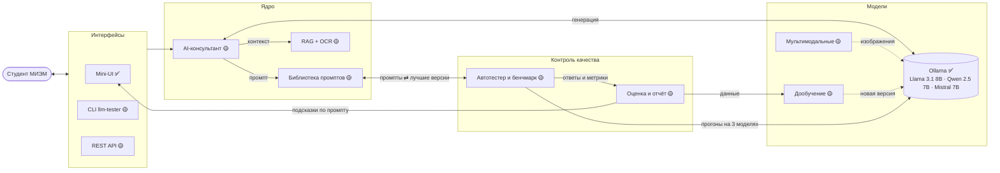
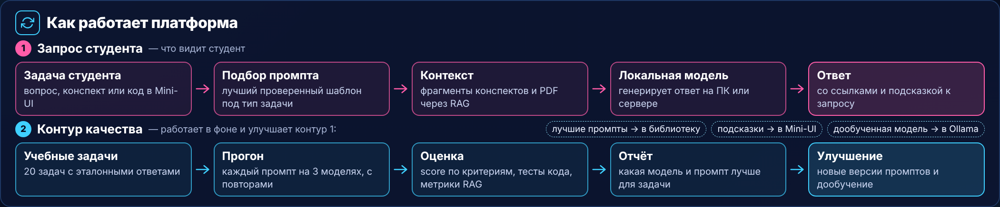
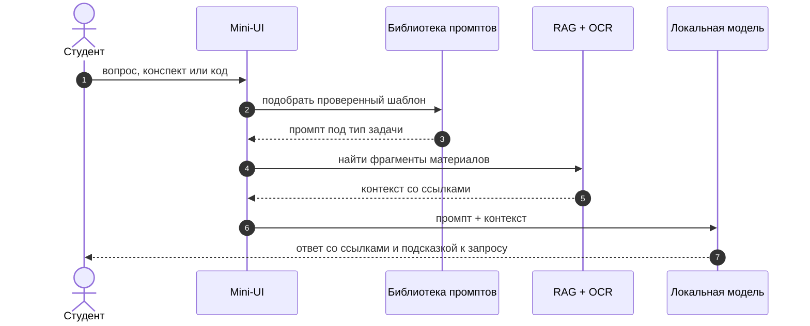
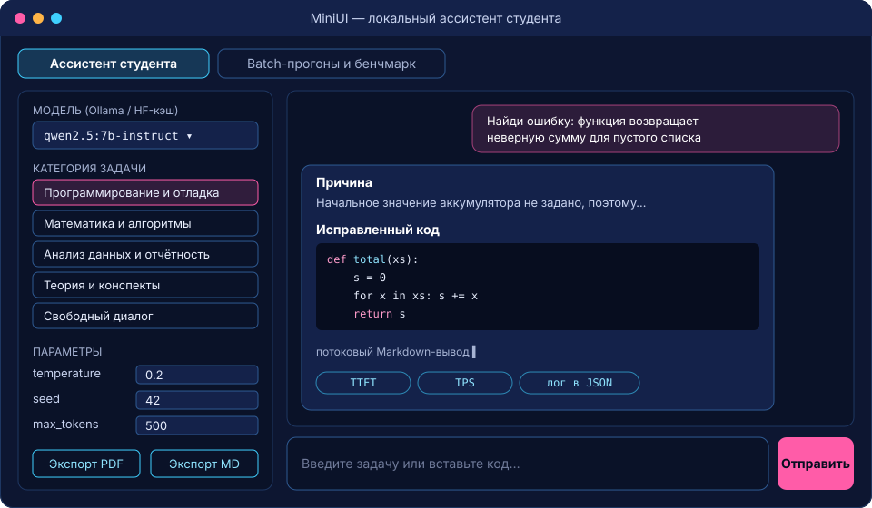
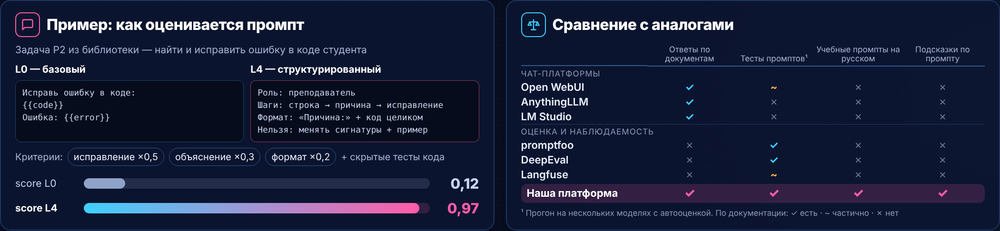
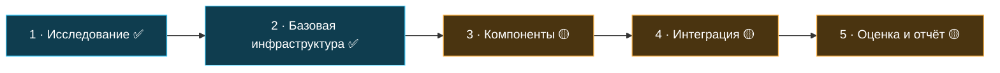
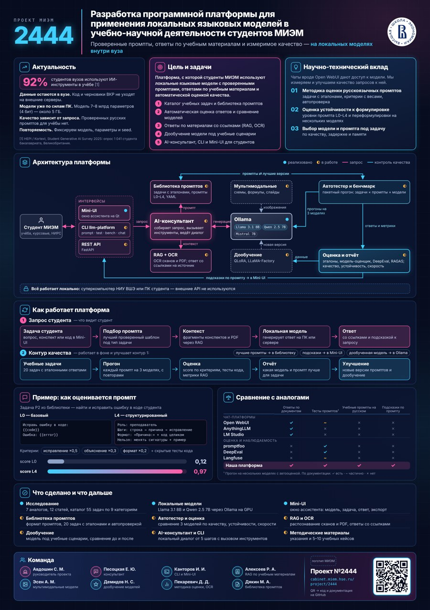

# LocLLM · Проект МИЭМ №2444

**Разработка программной платформы для применения локальных языковых моделей в учебно-научной деятельности студентов МИЭМ**

Проверенные промпты, ответы по учебным материалам и измеримое качество — на локальных моделях внутри вуза. Модели запускаются на суперкомпьютере НИУ ВШЭ или на ПК студента; внешние API для работы с данными студентов не используются.

Этот репозиторий — точка входа в проект: план, готовые инструменты со ссылками, архитектура и примеры интерфейсов. Код каждого компонента живёт в отдельном репозитории участника.

> Описание компонентов составлено по README их репозиториев. Статусы и цифры уточняйте у авторов.

---

## Содержание

- [Готовые инструменты](#готовые-инструменты)
- [Архитектура](#архитектура)
- [Как работает платформа](#как-работает-платформа)
- [Примеры интерфейсов](#примеры-интерфейсов)
- [Методика оценки промптов](#методика-оценки-промптов)
- [План работ](#план-работ)
- [Быстрый старт](#быстрый-старт)
- [Команда](#команда)

---

## Готовые инструменты

| Компонент | Что делает | Стек | Статус | Репозиторий |
|---|---|---|---|---|
| **MiniUI и llm-tester** | Окно ассистента студента и CLI для пакетного тестирования моделей | PyQt, Typer, SQLite | ✅ реализовано | [XReif-S/AIhelper](https://github.com/XReif-S/AIhelper) |
| **Локальный RAG-ассистент** | Ответы по лекциям со ссылками на источники, чат и API | LlamaIndex, ChromaDB, Docling, Ollama, FastAPI | 🟡 в работе | [skwlal/local-rag-assistant](https://github.com/skwlal/local-rag-assistant) |
| **OCR-сервис** | Распознавание текста на изображениях и PDF | FastAPI, Celery, Redis, Tesseract, EasyOCR, PaddleOCR | 🟡 в работе | [Dent0/OCR-P2444](https://github.com/Dent0/OCR-P2444) |
| **Мультимодальный ассистент** | Разбор учебных изображений: код, графики, формулы, слайды, схемы | Ollama, Streamlit, LLM-as-a-Judge | 🟡 в работе | [evixetiqufu042-sys/locllm-multimodal](https://github.com/evixetiqufu042-sys/locllm-multimodal) |
| **Библиотека промптов и методика оценки** | Учебные задачи с эталонами, критерии с весами, автопроверка | YAML, Python | 🟡 в работе | — |
| **Дообучение** | Адаптация модели под учебные сценарии | QLoRA, LLaMA-Factory | 🟡 в работе | — |

<details>
<summary><b>MiniUI и llm-tester</b> — ассистент студента и бенчмарк моделей</summary>

- Графический интерфейс на PyQt (PyQt6, PySide6 или PyQt5).
- Сам находит модели: опрашивает Ollama (`GET /api/tags`) и кэш Hugging Face.
- Категории учебных задач: программирование и отладка, математика и алгоритмы, анализ данных, теория и конспекты, свободный диалог.
- Потоковый Markdown-вывод, лог диалогов в JSON, экспорт в PDF и Markdown.
- `llm-tester`: матрица «модели × промпты × входные данные», 18 метрик (TTFT, TPS, ITL P50/P95/P99 и др.), ассерты (`contains`, `regex`, `json_valid`…), кэш на SQLite, отчёты HTML/PDF/Markdown.
- Источники моделей: Ollama, LM Studio, vLLM, OpenAI-совместимые API, Hugging Face Transformers.

```bash
pip install -e ".[all]"
python run_gui.py                                  # MiniUI
llm-tester bench -c test_config.yaml               # бенчмарк
llm-tester report --id latest --format html        # отчёт
```

Документация: [developer guide](https://github.com/XReif-S/AIhelper/blob/HEAD/docs/developer_guide.md) · [user guide](https://github.com/XReif-S/AIhelper/blob/HEAD/docs/user_guide.md) · [формат данных](https://github.com/XReif-S/AIhelper/blob/HEAD/docs/data_specification.md)
</details>

<details>
<summary><b>Локальный RAG-ассистент</b> — ответы по учебным материалам со ссылками</summary>

- Документы: PDF, DOCX, PPTX, TXT, Markdown.
- Поиск по смыслу, гибридный поиск и реранкинг фрагментов.
- Ответы локальных моделей через Ollama со ссылками на использованные материалы.
- Терминальный чат (`/models`, `/model`, `/sources`, `/ingest`) и HTTP API (`/ingest`, `/rag`, `/generate`, `/models`).
- Четыре эксперимента: разбиение документов, способы поиска, LLM с RAG и без, модели эмбеддингов.
- 90 вопросов с эталонными ответами по 15 документам.

```bash
cd local_rag_service && uv sync --frozen --python 3.13
ollama pull qwen3.5:9b
uv run --frozen python chat.py --model qwen3.5:9b --ingest
```

Документация: [техническое руководство](https://github.com/skwlal/local-rag-assistant/blob/HEAD/local_rag_service/TECHNICAL_GUIDE.md) · [выбор моделей](https://github.com/skwlal/local-rag-assistant/blob/HEAD/MODEL_SELECTION.md) · [проверки](https://github.com/skwlal/local-rag-assistant/blob/HEAD/local_rag_service/VALIDATION.md)
</details>

<details>
<summary><b>OCR-сервис</b> — текст из сканов, фото и PDF</summary>

- Асинхронная обработка: FastAPI принимает файл, Celery-воркер распознаёт, результат забирается по `task_id`.
- Три движка: Tesseract, EasyOCR, PaddleOCR.
- Форматы: PNG, JPG, JPEG, TIFF, BMP, PDF.
- Мониторинг: Prometheus, Grafana, Flower. Нагрузочные тесты: Locust.
- CLI `ocr_batch.py` для пакетной обработки папки на всех ядрах.

```bash
docker-compose up -d --build
curl -X POST http://localhost:8000/ocr/submit -F "file=@scan.png" -F "engine=tesseract"
curl http://localhost:8000/ocr/result/<task_id>
```

В связке с RAG закрывает страницы без текстового слоя: сканы конспектов, фото доски, PDF-картинки.
</details>

<details>
<summary><b>Мультимодальный ассистент</b> — разбор учебных изображений</summary>

- Пайплайн тестирования локальных мультимодальных моделей (Moondream2, Mistral NeMo Vision, Llama-3-Vision).
- Набор из 150 учебных изображений и 15 учебных задач.
- Автоматическая оценка ответов (LLM-as-a-Judge) и веб-интерфейс на Streamlit.

```bash
pip install -r requirements.txt
./run.sh
```

Отчёт: [REPORT.md](https://github.com/evixetiqufu042-sys/locllm-multimodal/blob/HEAD/REPORT.md)
</details>

---

## Архитектура



Тот же контур в виде диаграммы (рендерится прямо на GitHub):



**Всё работает локально:** суперкомпьютер НИУ ВШЭ или ПК студента.

---

## Как работает платформа





Во втором контуре (в фоне) учебные задачи с эталонами прогоняются на нескольких моделях, ответы оцениваются, а лучшие версии промптов возвращаются в библиотеку и в подсказки Mini-UI.

---

## Примеры интерфейсов

**Mini-UI** — схема окна по описанию из README (не скриншот):



**Мультимодальный ассистент** — скриншоты из репозитория участника:

| Главный экран | Ответ модели |
|---|---|
|  |  |

**RAG-чат** — терминал:

```text
$ uv run python chat.py --model qwen3.5:9b
> /sources                 # показать источники последнего ответа
> /model gemma-4-12b       # сменить модель
> Что такое собственный вектор матрицы?
  ... ответ модели со ссылками вида [S1], [S2]
```

**OCR-сервис** — ответ API:

```json
{
  "status": "success",
  "text": "Распознанный текст...",
  "char_count": 3415,
  "word_count": 470,
  "total_time": 7.058,
  "engine": "tesseract"
}
```

---

## Методика оценки промптов

Каждая учебная задача хранит переменные, формат ответа, критерии с весами (сумма = 1) и примеры с эталонными ответами. Один и тот же запрос пишется на нескольких уровнях — от базового L0 до структурированного L4 — и прогоняется на нескольких моделях.



Набор v0.1: 20 задач в 5 категориях и 5 поведенческих проверок.

| Категория | Задачи |
|---|---|
| Анализ текстов | A1 разбор аннотации · A2 термины и определения · A3 рецензия · A4 параметры из документации |
| Суммаризация | S1 тезисы лекции · S2 реферат документации · S3 протокол встречи · S4 аннотация к своей работе |
| Объяснение | E1 понятие под уровень · E2 сравнение понятий · E3 пошаговый разбор · E4 типичные заблуждения |
| Программирование | P1 функция по спецификации · P2 исправление ошибки · P3 ревью кода · P4 объяснение кода |
| Генерация упражнений | G1 задачи по уровням · G2 тест по конспекту · G3 карточки · G4 проверка решения |
| Поведение | B1 «реши за меня» · B2 нехватка данных · B3 вопрос не по теме · B4 битый ввод · B5 выдуманные источники |

---

## План работ



**1. Исследование**
- [x] Обзор 7 аналогов и 12 статей
- [x] Каталог 55 учебных задач по 9 категориям

**2. Базовая инфраструктура**
- [x] Локальные модели через Ollama (Llama 3.1 8B, Qwen 2.5 7B)
- [x] Mini-UI: окно ассистента — модель, задача, ответ, экспорт

**3. Компоненты**
- [ ] Библиотека промптов: формат, 20 задач с эталонами и автопроверкой
- [ ] Автотестер и оценка: сравнение моделей по качеству, устойчивости, скорости
- [ ] RAG и OCR: распознавание сканов и PDF, ответы со ссылками
- [ ] Мультимодальные модели: разбор схем, формул, слайдов
- [ ] Дообучение модели под учебные сценарии, сравнение до и после

**4. Интеграция**
- [ ] AI-консультант и CLI: локальный диалог с вызовом инструментов
- [ ] REST API и подключение RAG, OCR и библиотеки к Mini-UI

**5. Оценка и отчёт**
- [ ] Прогон набора задач на 3 моделях, отчёт «какая модель и промпт лучше для задачи»
- [ ] Методические материалы: указания и 5–10 учебных кейсов

---

## Быстрый старт

1. Установите [Ollama](https://ollama.com) и скачайте модель:
   ```bash
   ollama pull qwen2.5:7b-instruct
   ```
2. Склонируйте нужный компонент из таблицы [Готовые инструменты](#готовые-инструменты) и следуйте его README.
3. Начать проще всего с Mini-UI: `pip install -e ".[all]" && python run_gui.py`.

---

## Команда

| Участник | Роль |
|---|---|
| Авдошин С. М. | руководитель проекта |
| Песоцкая Е. Ю. | консультант |
| Канторов И. И. | CLI и Mini-UI |
| Алексеев Р. А. | RAG по учебным материалам |
| Эсен А. М. | мультимодальные модели |
| Демидов Н. С. | дообучение моделей |
| Пекаревич Д. Д. | методика оценки, OCR |
| Дякин М. А. | библиотека промптов |

<p align="center">
  <br>
  <sub>Постер проекта · <a href="https://cabinet.miem.hse.ru/project/2444">cabinet.miem.hse.ru/project/2444</a></sub>
</p>
